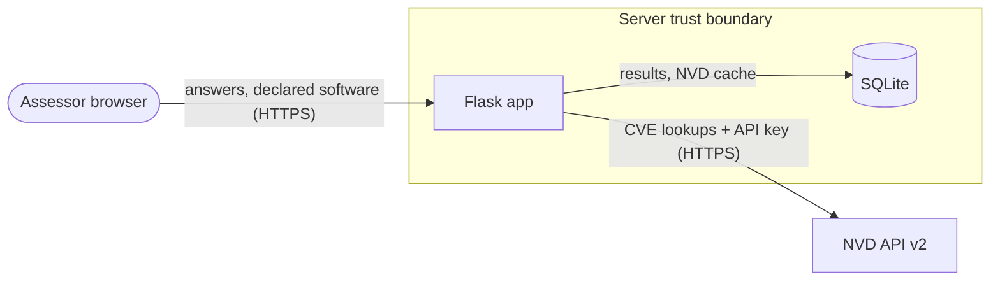

The E8 Audit Tool is a Flask web app that automates part of an Essential Eight maturity assessment. I wanted it to answer something more useful than "are we patched?", which is "what are we exposed to right now?". This post explains how it works and then threat-models the tool itself. A security tool nobody has threat-modelled is just more attack surface, and it felt hypocritical to skip that step on my own code.

## What it does

The tool checks four of the eight controls in ASD's Essential Eight:

- Patch management
- Microsoft Office macro hardening
- Restriction of administrative privileges
- Backup status

Each control is its own check and returns a maturity score. A written rubric maps each result to ACSC Maturity Levels 1 to 3, so two assessors running the tool on the same environment get the same answer. The scores then roll up into an overall posture.

Patch management is where most of the work happens. It takes the software an organisation declares, looks up CVEs for it in the NIST National Vulnerability Database, and weights the result by severity. Managers get a headline score on a Chart.js dashboard, and engineers can drill down to the exact CVEs behind a low patch score.

## How it fits together



Anything coming from outside the trust boundary is untrusted input. The assessor's browser is the obvious one. The NVD is easier to forget, but CVE descriptions are third-party text and the app displays them.

## Threat-modelling my own tool with STRIDE

For each STRIDE category I wrote down where it could bite this app and what the control should be.

| STRIDE | Where it could bite | The control |
| --- | --- | --- |
| Spoofing | A hard-coded Flask `SECRET_KEY` lets anyone forge session cookies | Secret from the environment, long and random, rotated if it ever lands in git |
| Tampering | Declared software names or answers concatenated into SQL | Parameterised queries everywhere |
| Repudiation | Assessment answers changed with no record of who or when | Append-only change log per assessment |
| Information disclosure | The NVD API key committed to the repo; Flask debug mode left on | Key in an environment variable; debug mode off outside development |
| Denial of service | Every dashboard view calling the NVD API and hitting its rate limit | Cache NVD responses in SQLite and pace requests |
| Elevation of privilege | CVE descriptions or software names rendered as HTML: stored XSS | Jinja autoescaping on, never `\|safe` on untrusted text |

## Three risks worth checking first

### 1. User input reaching SQL

Declared software names come straight from the assessor. The vulnerable and safe versions differ by one line:

```python del={2} ins={4}
# Vulnerable: user input becomes part of the SQL statement
db.execute(f"SELECT * FROM software WHERE name = '{name}'")
# Safe: the driver keeps the query and the data apart
db.execute("SELECT * FROM software WHERE name = ?", (name,))
```

With the input `x' OR '1'='1`, the first query returns every row in the table and the second returns none.

### 2. Third-party text in the dashboard

NVD descriptions and declared software names both end up on screen. Jinja escapes them by default, but that protection is gone the moment a template uses `|safe` on them. Chart.js draws onto a canvas, so the chart labels themselves can't inject HTML. The risk is in the bits around the chart: custom HTML tooltips, legends and the drill-down CVE table.

### 3. The NVD key and its rate limits

The NVD allows 5 requests in a rolling 30-second window without an API key and 50 with one, and still recommends pausing between requests ([NVD developer guide](https://nvd.nist.gov/developers/start-here)). So the client keeps the key out of the code, lets the HTTP library encode the query, and caches results so viewing the dashboard doesn't call the API at all:

```python
NVD_URL = "https://services.nvd.nist.gov/rest/json/cves/2.0"
API_KEY = os.environ.get("NVD_API_KEY", "")  # from the environment, never the repo


def fetch_cves(keyword: str) -> dict:
    resp = requests.get(
        NVD_URL,
        params={"keywordSearch": keyword, "resultsPerPage": 50},  # requests encodes these
        headers={"apiKey": API_KEY},
        timeout=30,
    )
    resp.raise_for_status()
    time.sleep(2)  # NVD asks clients to pause between requests
    return resp.json()
```

## The review checks, in one place

```bash
# static analysis
semgrep --config p/python --config p/flask .

# secrets in the repo and its history
gitleaks detect --source .

# known-vulnerable dependencies
pip-audit -r requirements.txt

# quick greps for the usual suspects
grep -rn "SECRET_KEY\|debug=True" .
grep -rn "|safe" templates/
```

## What building it taught me

Writing the rubric down got rid of the inconsistency you get when people score Essential Eight controls by hand. Linking patch status to live CVEs also changed how the results read. A score tied to real CVEs reads as current risk, which is far more useful than a compliance tick. If you try this approach, cache the NVD responses and schedule re-assessments, because new vulnerabilities come out every day.

Threat-modelling the tool surprised me. The input box I worried about first turned out to be the boring part. The more interesting risk was the feed I trusted: text from a government API that the app had been treating as safe to display without anyone really questioning it.

## Next

Next on my list is an Essential Eight extension for AI controls. The question I keep coming back to: what does "restrict administrative privileges" mean when an AI agent is the one holding the credentials?
